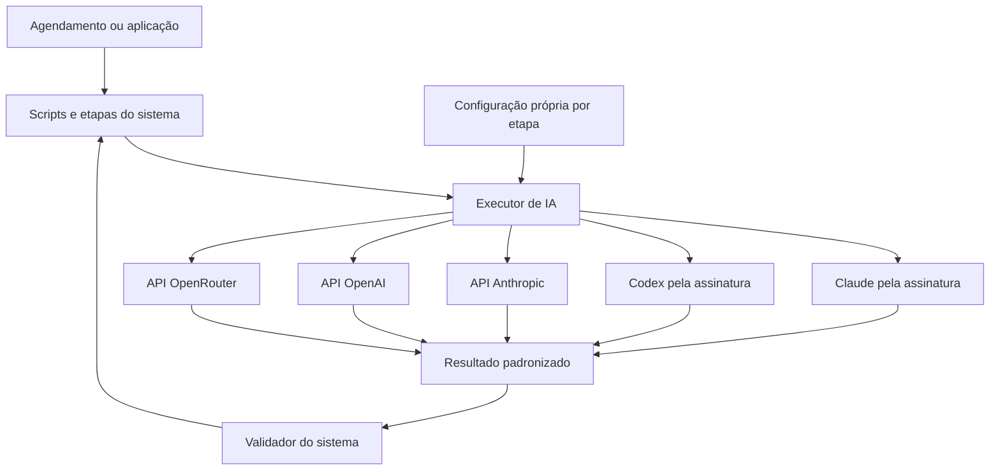

# Provedores independentes por etapa

Referência para adaptar um sistema a vários motores de IA sem precisar editar o código a cada troca de modelo. Base: implementação do gitbombando, concluída em 15/11/2026, versão 1.7.1, commit `19caa47`.

A regra central é separar **o trabalho do sistema** da **chamada ao modelo**. Os scripts coletam dados, salvam arquivos, validam resultados e publicam. O executor de IA recebe uma etapa e busca na configuração seu tipo, motor, modelo e esforço. Cada adaptador traduz esse pedido para seu provedor.



Essa separação permite trocar o modelo de uma etapa sem mudar seu formato de entrada/saída nem o restante do fluxo. Ela não torna ferramentas externas automaticamente disponíveis para todos os motores.

## Como usar esta referência

O levantamento dos outros sistemas está em [CRONS-2026-11-15.md](CRONS-2026-11-15.md), com [inventário técnico](inventario-crons-2026-11-15.json) de timers, crontab e schedulers YouTube.

| Arquivo | Uso |
|---|---|
| [AVENTURA-2026-11-15.md](AVENTURA-2026-11-15.md) | Exemplo de produtor contínuo com agente, classificação visual e retomada após falha de cota |
| [COMO-ADAPTAR.md](COMO-ADAPTAR.md) | Ordem de implementação e pontos do código que precisam ser adaptados |
| [configuracao.exemplo.yaml](configuracao.exemplo.yaml) | Exemplo válido, com as cinco opções explicadas em comentários `#` e todas as APIs desativadas |
| [AUTENTICAR-METRICOOL-NO-CODEX.md](AUTENTICAR-METRICOOL-NO-CODEX.md) | Procedimento OAuth no perfil correto e validação da conta |
| [TESTES-E-LIMITES.md](TESTES-E-LIMITES.md) | Evidências reais, limites e verificação necessária para outro sistema |
| [PEDIDO-PARA-ADAPTAR.md](PEDIDO-PARA-ADAPTAR.md) | Texto pronto para pedir a adaptação de outro projeto |

Pedido de referência futura: **“Adapte o sistema X seguindo `~/projetos/wifi/provedores-independentes/`, mantendo as regras e os validadores dele.”**

## As cinco opções

| Tipo | Motor | Execução | Referência de autenticação |
|---|---|---|---|
| assinatura | claude | Claude Code CLI com modelo/esforço explícitos | Login da assinatura |
| assinatura | codex | Codex CLI com modelo/esforço explícitos | Login da assinatura |
| api | anthropic | Messages API diretamente | Nome da chave no `.env` |
| api | openai | Responses API diretamente | Nome da chave no `.env` |
| api | openrouter | Chat Completions API diretamente | Nome da chave no `.env` |

“Codex pela API” significa usar um modelo disponível na API da OpenAI, pelo adaptador `openai`. Não significa colocar uma chave de API no Codex CLI. Os CLIs continuam exclusivamente pelas assinaturas, conforme a regra do Nei. O ID e o acesso de um modelo na API podem diferir da assinatura.

## O que foi implementado

A implementação concreta está em `~/projetos/gitbombando/`:

| Arquivo | Responsabilidade |
|---|---|
| `auto/ia.yaml` | Fonte exclusiva dos tipos, motores, modelos, esforços e autorizações por etapa |
| `auto/ia.py` | Validação, seleção de motor, adaptadores, credenciais, execução e registro |
| `ia` | Comandos sem menu: ver, configurar, validar e executar |
| `auto/roteiro.py` | Salvar YAML e devolver erros do portão ao modelo, até duas tentativas |
| `gb.py` | Integração da capa e revisão do vídeo |
| `carrossel/carrossel.py` | Integração dos textos, revisão e publicação dos carrosséis |
| `carrossel/area.py` | Filtro dos projetos por tema |
| `auto/intervalo.py` | Trava de 1 hora entre publicações do Metricool, com consulta configurável |
| `tests/test_ia.py` | 23 testes automáticos sem rede |
| `tests/teste_motores_reais.py` | Teste manual de roteiro em pasta isolada |
| `tests/resultados/2026-11-15.json` | Evidência dos dois testes reais aprovados |

Esta pasta documenta o método. **Não é uma biblioteca universal pronta para importar.** A implementação do gitbombando conhece suas oito etapas, seus caminhos, seus validadores e suas restrições de ferramenta. Ao adaptar outro sistema, esses pontos precisam ser ajustados uma vez; depois, as trocas compatíveis ficam na configuração.

## Estado do gitbombando após a ativação

- Roteiro, filtro, textos e revisões: API Anthropic, com Opus 5.5; esforço low para escrita/filtro e medium para revisão.
- Imagem da capa: Codex por assinatura com image_gen, mantida conforme pedido do Nei.
- Metricool: Codex por assinatura com o conector MCP autenticado. Claude por assinatura também é aceito na configuração. A API de texto/visão não executa esse conector.
- OpenAI e OpenRouter: adaptadores implementados e simulados nos testes, sem autorização de consumo nem testes reais de rede.

A autorização de operação da Anthropic vale para as cinco etapas do **gitbombando** listadas no seu YAML. Não deve ser copiada como autorização para outro projeto ou serviço.

## Configuração que o usuário consegue manter

Os quatro campos principais são `tipo`, `motor`, `modelo` e `esforco`. Há ainda `timeout`, `max_tokens` para API e referências de credenciais. Exemplos devem ficar **com `#` no próprio arquivo de configuração**, para consulta durante a edição. O comando que altera valores precisa preservar esses comentários.

No gitbombando:

```bash
cd ~/projetos/gitbombando
./ia ver
./ia configurar roteiro --esforco medium
./ia configurar roteiro --tipo assinatura --motor codex --modelo gpt-6.1-sol --esforco medium
./ia validar
```

`ver`, `configurar` e `validar` não chamam modelos. A validação local não consulta saldo, catálogo ou disponibilidade de um modelo. A próxima chamada lê os novos valores; uma chamada em andamento termina com a configuração que já recebeu.

O projeto continua independente das seleções globais de modelo/esforço, mas pode reutilizar os logins e conectores já instalados. Essa escolha precisa ficar documentada como exceção à fonte central de modelos do ecossistema.

Em 15/11/2026 o Metricool também foi validado pelo Codex após OAuth no perfil ~/.codex-2, usando o conector separado metricool-inematds: conta inematds@gmail.com confirmada, cinco marcas encontradas e cinco posts lidos na agenda da inema.tds para 15–17/11. Nenhuma publicação foi criada ou alterada. A primeira tentativa, pelo alias metricool sem login, tinha falhado com AuthRequired; o procedimento está em [AUTENTICAR-METRICOOL-NO-CODEX.md](AUTENTICAR-METRICOOL-NO-CODEX.md). Após a validação, o executor foi integrado e as duas etapas passaram ao Codex/MCP. A publicação real de carrosséis e vídeos foi aceita; há trava por marca durante consulta, criação e recibo para manter o intervalo mínimo.

As publicações de marcas/canais diferentes podem coincidir. O mesmo conteúdo pode sair ao mesmo tempo no Instagram e TikTok. O intervalo de 1 hora vale entre conteúdos diferentes da mesma marca, não entre todo o sistema. A semana/mês mantém ainda 2h/4h em relação ao vídeo do dia na mesma marca.

## Todos os crons: comando único (15/11/2026)

Acompanhamento com estado e evidências: [ADAPTACAO-TODOS.md](ADAPTACAO-TODOS.md). O atalho local ia-crons permite ver e trocar sem editar código:

```bash
ia-crons listar
ia-crons ver clima
ia-crons configurar clima roteiro_mundo --tipo assinatura --motor codex --modelo gpt-6.1-sol --esforco high
ia-crons configurar finviral roteiro_curto_diario --tipo assinatura --motor claude --modelo claude-opus-5-5 --esforco medium
ia-crons ver lives4
ia-crons ver yt-pubx
```

Os arquivos YAML guardam exemplos com # e o comando preserva os comentários. Cada projeto/canal tem sua própria configuração. Hindsight pede reiniciar o serviço após mudar; os demais lêem na próxima execução. Etapas de agente/MCP exigem ferramentas e assinatura; não prometem executar código por API de texto. Imagens permanecem Codex pela assinatura. Tradução mantém inema-traduz.

A conta Metricool pub2 permanece na assinatura Claude e depende da cota (reset informado em 16/11 às 21h) ou autenticação separada no Codex; o OAuth inematds não serve como autorização dessa conta. APIs de modelos fora do Gitbombando ficam desativadas. Nenhuma rotina desabilitada foi ativada.
